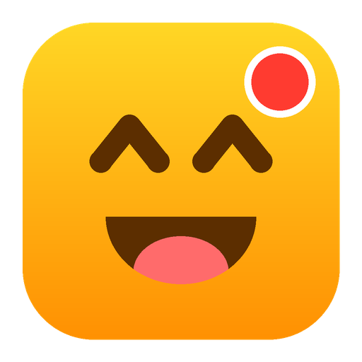
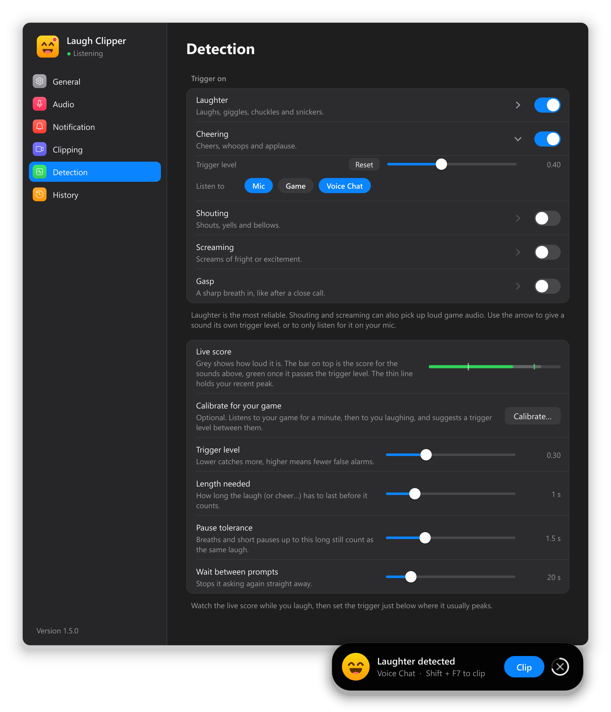
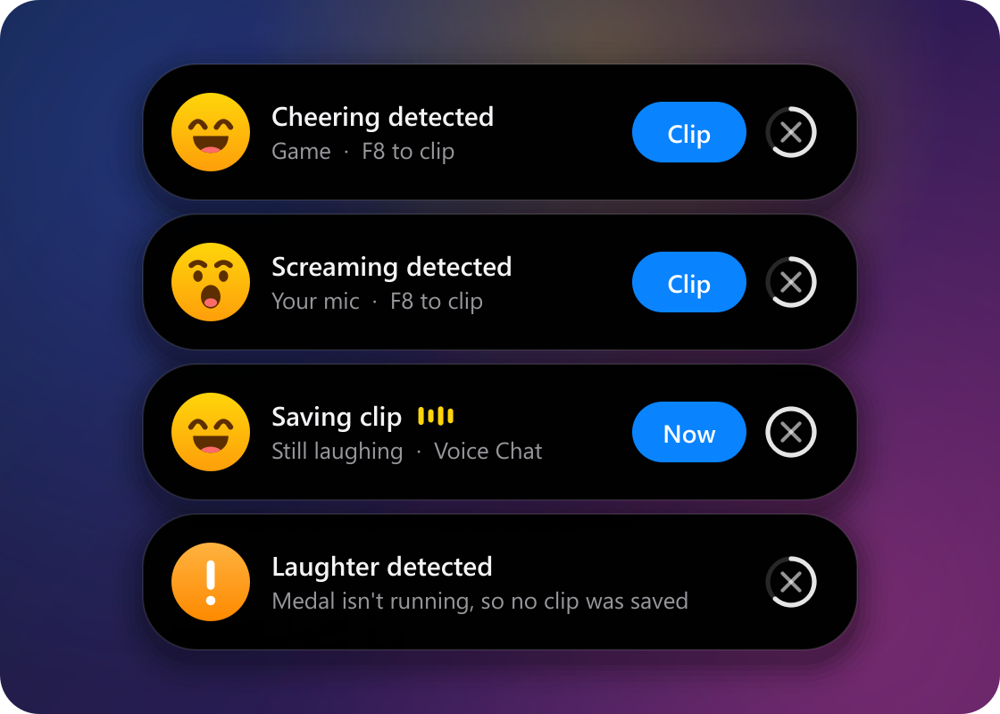
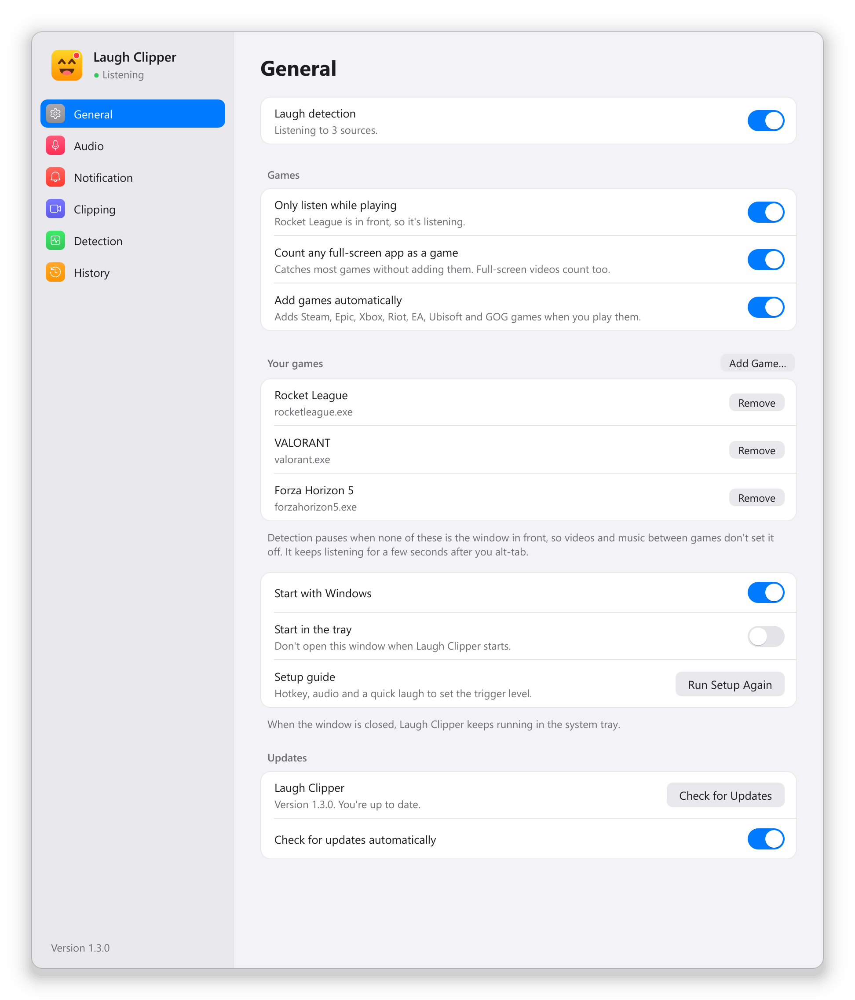
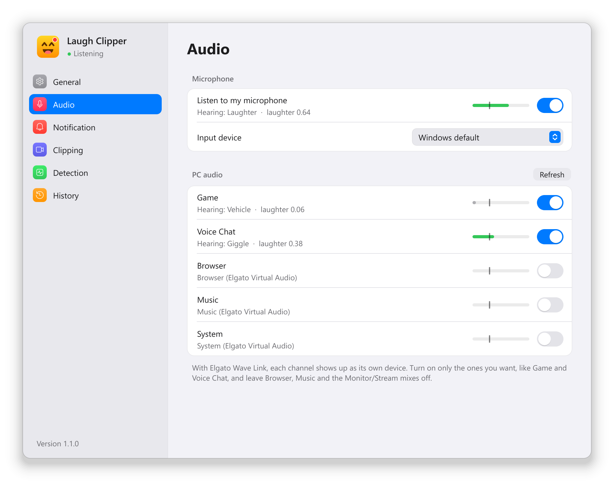
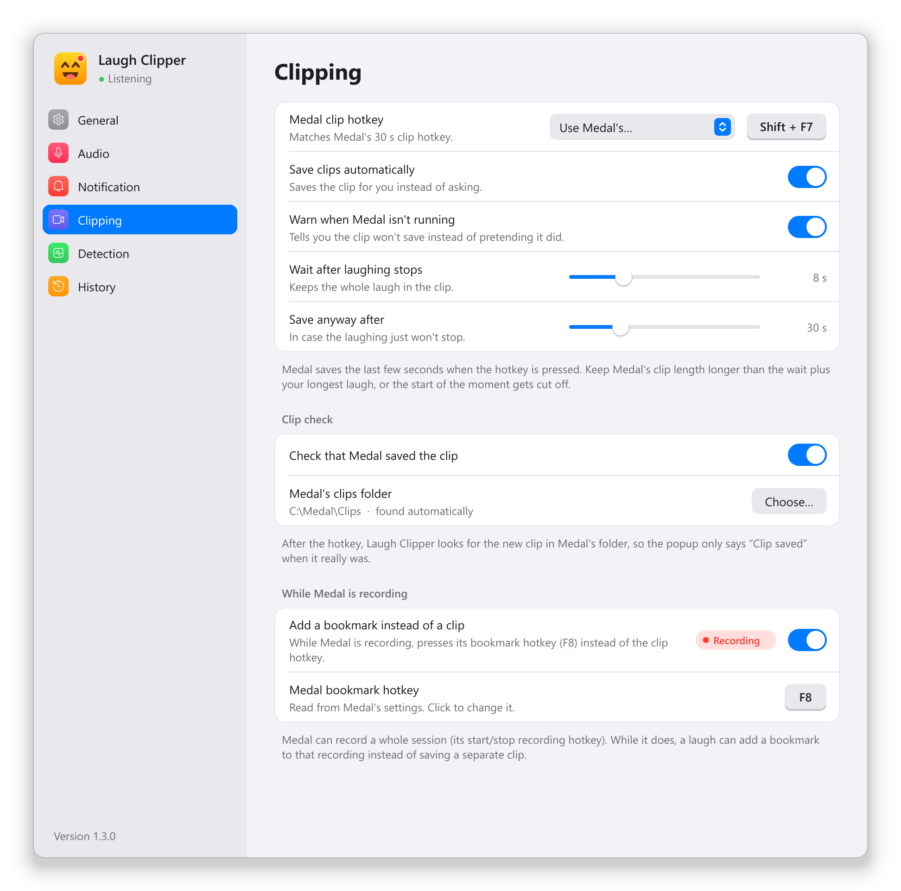
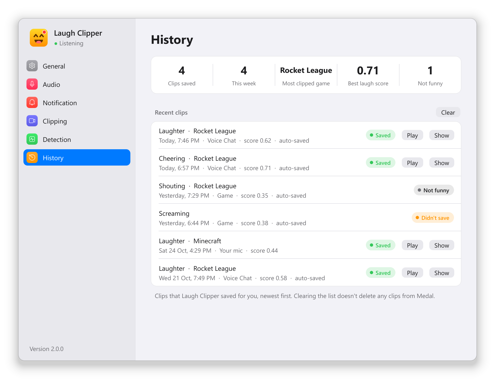
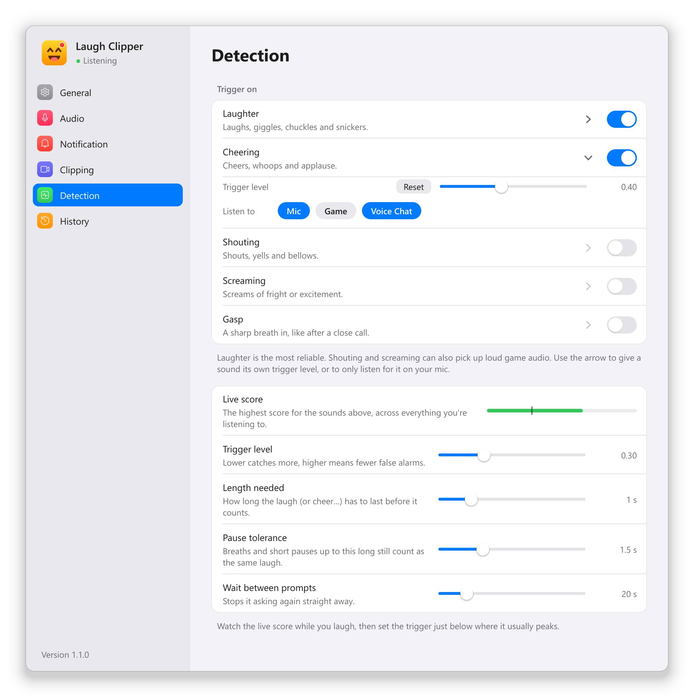
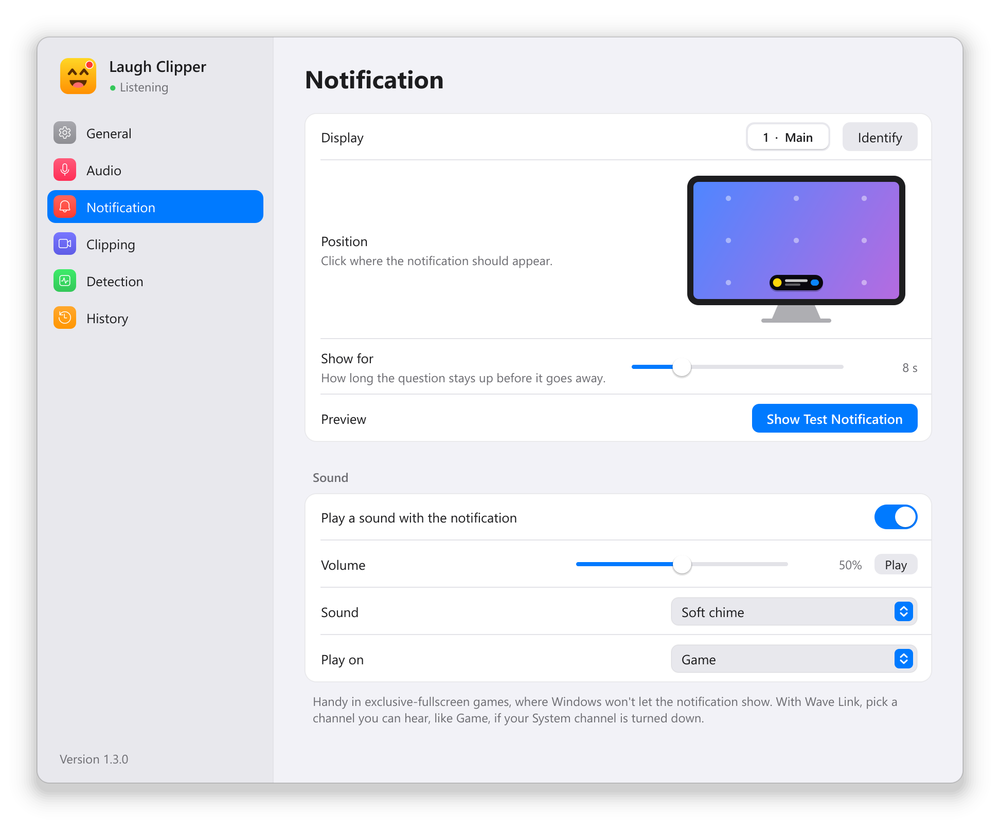

<div align="center">



# Laugh Clipper

**Never miss the funniest moment of the stream again.**

Laugh Clipper listens for laughter, cheering and screams while you play,
and saves a [Medal](https://medal.tv) clip for you, or asks first.

[](https://github.com/Bryson-he/laugh-clipper/releases/latest)
[](https://github.com/Bryson-he/laugh-clipper/releases)

[](LICENSE)

### [⬇&nbsp; Download for Windows](https://github.com/Bryson-he/laugh-clipper/releases/latest) &nbsp;·&nbsp; [Website](https://bryson-he.github.io/laugh-clipper/)



</div>

## How it works

Laugh Clipper runs quietly in your system tray and listens to your mic and whichever PC audio you pick, like game
audio or voice chat. When it hears someone properly laughing, it pops up a small notification over your game. Click
**Clip** (or press your Medal hotkey) and Medal saves the last few seconds. Or let it save the clip for you.

<table>
<tr>
<td width="50%" align="center">
<br>
<b>Ask first</b><br>
<sub>A popup asks if you want the clip. One click and it's saved.</sub>
</td>
<td width="50%" align="center">
<br>
<b>Save automatically</b><br>
<sub>It waits until the laughing stops, so the whole moment makes it into the clip.</sub>
</td>
</tr>
</table>

The popup never steals focus from your game, and it doesn't send anything to Medal until you (or auto-save) say so.
Changed your mind? Say **"don't clip"** and it's cancelled. Not actually funny? Press 👎 and it gets a little stricter
about that sound.

## Features

### 😂 Catches more than laughs

Pick what counts as a moment worth clipping: **laughter, cheering, shouting, screaming or gasps**. The popup tells you
what it heard and where it heard it: your mic, game audio or voice chat.

Each sound can have its own trigger level and its own sources. For example, listen for shouting only on your mic and
voice chat, so explosions in the game don't set it off.

<div align="center">

</div>

### 🎮 Only listens while you're playing

Turn on **Only listen while playing** and detection pauses whenever a game isn't the window in front, so a funny
YouTube video between matches won't clip anything.

- Games you play from **Steam, Epic, Xbox, Riot, EA, Ubisoft and GOG** are added automatically.
- Anything running full-screen counts too.
- Add any other game from the list of open apps, or browse for its `.exe`.
- Quick alt-tabs don't pause it: it keeps listening for 5 seconds.

<div align="center">
<picture>
  <source media="(prefers-color-scheme: dark)" srcset="docs/images/settings-general-dark.png">
  
</picture>
</div>

### 🎧 Hears your mic, game and voice chat separately

Listen to your microphone and any of your PC's audio outputs at once, each with its own live meter: grey shows
how loud it is, and the bar on top shows how much it sounds like laughing (green once it would trigger). With
**Elgato Wave Link**, every channel (Game, Voice Chat, Music…) shows up separately, so you can listen to the game and
your friends but ignore your music.

<div align="center">
<picture>
  <source media="(prefers-color-scheme: dark)" srcset="docs/images/settings-audio-dark.png">
  
</picture>
</div>

### 🔖 Bookmarks your recordings

Recording a whole session in Medal? Turn on **Add a bookmark instead of a clip** and, while Medal is recording, a laugh
drops a bookmark into the recording instead of saving a separate clip. It notices recordings however you start them.

Laugh Clipper also reads your clip and bookmark hotkeys straight from Medal's settings, so you don't have to type
them in, and it warns you if they don't match.

<div align="center">
<picture>
  <source media="(prefers-color-scheme: dark)" srcset="docs/images/settings-clipping-dark.png">
  
</picture>
</div>

### 🗣️ Say "don't clip"

Turn on **Clipping → Cancel with your voice** and, while a popup is up, just say **"don't clip"** (or "cancel clip")
to call it off, even during an auto-save countdown. Speech recognition runs offline on your PC with
[Vosk](https://alphacephei.com/vosk/), listens only for those few words, and only while a popup is showing.

### 👎 Learns what isn't funny

Each popup has a **Not funny** button. Press it and that clip is skipped, and the trigger level for that sound goes
up a little, so the same kind of noise is less likely to set it off next time. You can always set it back on the
Detection page.

### ✅ Knows when a clip really saved

After pressing Medal's hotkey, Laugh Clipper watches Medal's clips folder and only says **Clip saved** once the new
clip is actually there. If Medal didn't make one (say the hotkey doesn't match), it tells you instead of pretending.
And if Medal isn't running at all, it warns you before you need it, with an **Open Medal** button.

Every clip goes into the **History** page: what was heard, where, in which game, and whether it saved, with
buttons to **Play** it or show it in its folder. Stats along the top show how many clips you've saved, this week's
count, your most clipped game and your best laugh.

<div align="center">
<picture>
  <source media="(prefers-color-scheme: dark)" srcset="docs/images/settings-history-dark.png">
  
</picture>
</div>

### ✨ And the rest

- **Quick setup:** a short guide on first launch sets your Medal hotkey and audio, and finds the right trigger level
  from a few seconds of laughing.
- **Tune it to your voice:** smooth live meters with a marker that holds your recent peak, so you can set the
  trigger level just below where your laughs land.
- **Calibrate for your game (optional):** it listens to your game for a minute, then to you laughing, and suggests
  a trigger level that catches your laughs but not the game's own sounds.
- **Longer clips for longer laughs:** with a few clip lengths set up in Medal (30, 60, 120 s…), it picks a longer
  one when the laughing goes on, so the start of a big moment isn't cut off.
- **What's new:** after each update, a short summary of what changed.
- **Optional sound:** a soft chime (or a pop, marimba or bell) when the popup appears, on any output you choose. Handy
  in exclusive-fullscreen games where the popup can't show.
- **Pause hotkey:** pick a key on the General page to pause and resume listening without opening anything.
- **Tray icon shows what it's doing:** grey when paused, an orange dot when it's waiting for a game or Medal is closed.
- **Put the popup anywhere:** any corner or edge of any monitor, and choose how long it stays up.
- **Looks at home on Windows 11:** follows your light or dark mode, with smooth, springy animations.
- **Starts with Windows** and lives in the system tray.
- **Updates itself:** when a new version is out, click **Update and Restart**.

<details>
<summary><b>📸 See every settings page</b></summary>
<br>

| | |
|---|---|
| <picture><source media="(prefers-color-scheme: dark)" srcset="docs/images/settings-detection-dark.png"></picture> | <picture><source media="(prefers-color-scheme: dark)" srcset="docs/images/settings-clipping-dark.png"></picture> |
| **Detection:** what to listen for, and how sensitive it is | **Clipping:** your Medal hotkey and auto-save |
| <picture><source media="(prefers-color-scheme: dark)" srcset="docs/images/settings-notification-dark.png"></picture> | <picture><source media="(prefers-color-scheme: dark)" srcset="docs/images/settings-general-dark.png"></picture> |
| **Notification:** which monitor, where, and for how long | **General:** games, pause hotkey, startup and updates |
| <picture><source media="(prefers-color-scheme: dark)" srcset="docs/images/settings-audio-dark.png"></picture> | <picture><source media="(prefers-color-scheme: dark)" srcset="docs/images/settings-history-dark.png"></picture> |
| **Audio:** your mic and PC audio, with live meters | **History:** every clip, stats, and whether it saved |

</details>

## Install

1. Download **`LaughClipper-Setup-x.y.z.exe`** from the [latest release](https://github.com/Bryson-he/laugh-clipper/releases/latest).
2. Run it. It installs just for you, so it doesn't need admin rights.
3. Windows may show **"Windows protected your PC"** because the installer isn't code-signed yet. Click
   **More info → Run anyway**.
4. If it says **"Smart App Control blocked an app that may be unsafe"** instead, see
   [the FAQ](#smart-app-control-blocks-laugh-clipper) below.

You'll also need [Medal](https://medal.tv) installed and running, since it's what actually records the clips.

## Getting started

The setup guide walks you through this on first launch (and any time from **General → Run Setup Again**):

1. **Match the hotkey.** It's filled in from Medal's settings when it can be read. Otherwise, on the **Clipping**
   page, click the key and press the same clip hotkey you use in Medal.
2. **Pick what to listen to.** On the **Audio** page, turn on your mic and the outputs your game and voice chat
   play through.
3. **Tune it.** On the **Detection** page, laugh a few times and watch the live score, then set the trigger level a
   little below where it peaks. Or click **Calibrate…** with your game running and let it work it out.
4. **Try it:** right-click the tray icon → **Show Test Notification**.

> [!TIP]
> Medal saves the last *N* seconds when you press the hotkey. Set Medal's clip length longer than Laugh Clipper's
> "Wait after laughing stops", plus your longest laugh, so the start of the moment doesn't get cut off.

## FAQ

<a id="smart-app-control-blocks-laugh-clipper"></a>
<details>
<summary><b>Smart App Control blocks Laugh Clipper.</b></summary>

Smart App Control is a stricter Windows 11 feature that blocks every app that isn't code-signed, with no
"Run anyway" option. Running as administrator doesn't help. Laugh Clipper isn't signed yet, so the only way to run it
on a PC with Smart App Control on is to turn it off:

**Start → Windows Security → App & browser control → Smart App Control settings → Off**

Heads up: on most PCs, Smart App Control can't be turned back on afterwards without resetting Windows. Most PCs
already have it off (Windows only enables it on fresh installs, and often switches it off by itself), so you'll only
see this on some machines.
</details>

<details>
<summary><b>The popup doesn't show up over my game.</b></summary>

Windows doesn't let anything appear over games running in **exclusive fullscreen**. Switch the game to
**borderless** or **windowed fullscreen**. Auto-save still works either way.
</details>

<details>
<summary><b>I can't hear the notification sound.</b></summary>

It plays on Windows' default output, which with Elgato Wave Link is usually the **System** channel. If that's turned
down in your mix, go to **Notification → Sound → Play on** and pick a channel you can hear, like **Game**.
</details>

<details>
<summary><b>Clips don't save in one particular game.</b></summary>

If that game runs as administrator, Windows blocks hotkeys sent from normal apps. Run Laugh Clipper as
administrator too (right-click it → **Run as administrator**). Also check the hotkey on the Clipping page matches
Medal's exactly.
</details>

<details>
<summary><b>It goes off when nobody's laughing.</b></summary>

Run **Detection → Calibrate…** with your game going, or raise the **Trigger level** by hand, or make
**Length needed** a bit longer. Turn off any
music or browser outputs on the Audio page, and try **Only listen while playing**.
</details>

<details>
<summary><b>Does it record or upload my audio?</b></summary>

No. Audio is analysed on your PC, one second at a time, and then thrown away. Nothing is recorded or sent anywhere.
That includes "don't clip": the speech recogniser runs offline and only listens while a popup is showing.
The only thing Laugh Clipper connects to is GitHub, to check for updates, and you can turn that off.
</details>

<details>
<summary><b>Where are my settings and the log?</b></summary>

In `%APPDATA%\Laugh Clipper`: `settings.json` and `laugh_clipper.log`. If something goes wrong, the log is the
first place to look.
</details>

## How it hears laughs

Every quarter of a second, Laugh Clipper runs the last second of audio from each source through
[YAMNet](https://github.com/tensorflow/models/tree/master/research/audioset/yamnet), Google's sound classifier,
which recognises 521 kinds of sound. It triggers when most of the last second or so sounds like laughing (or
cheering, and so on), so one breath in the middle doesn't stop it. Quiet audio is skipped entirely, so it uses
very little CPU.

## For developers

<details>
<summary><b>Run from source, build and release</b></summary>
<br>

You'll need Python 3.12 on Windows.

```
py -3.12 -m venv .venv
.venv\Scripts\python -m pip install -r requirements.txt
.venv\Scripts\python tools\fetch_model.py
.venv\Scripts\python main.py
```

`tools\fetch_model.py` downloads the YAMNet sound model and the small Vosk speech model into `models\`.

`build_local.bat` builds `dist\LaughClipper\LaughClipper.exe` on your own PC (no installer, no auto-updates).

**Tests** run offscreen with fake audio, games and Medal, and on GitHub for every push:

```
.venv\Scripts\python -m pip install -r requirements-dev.txt
.venv\Scripts\python -m pytest
```

**Releasing:** write the notes in `release-notes/vX.Y.Z.md`, commit, then tag and push:

```
git tag vX.Y.Z
git push origin vX.Y.Z
```

GitHub Actions builds the app and the installer and publishes the release. Installed copies see it within a few
hours, or straight away with **Check for Updates**.

**README images** are rendered from the real app: `.venv\Scripts\python tools\make_readme_media.py` (needs
`pillow`, which `requirements-dev.txt` installs).

| Path | What it is |
|---|---|
| `laughclipper/engine.py` | Audio capture and sound detection (YAMNet via MediaPipe) |
| `laughclipper/app.py` | Tray, hotkeys, popups, games and Medal checks, clipping, updates |
| `laughclipper/toast.py` | The animated popup |
| `laughclipper/settings_window.py`, `widgets.py`, `theme.py` | Settings window and hand-painted controls |
| `laughclipper/updater.py` | Checks GitHub Releases and installs updates |
| `laughclipper/clips.py` | Checks Medal saved each clip, and the clip history |
| `laughclipper/setup_guide.py` | The first-run setup guide |
| `laughclipper/whatsnew.py` | "What's new" window (bundled release notes) |
| `laughclipper/calibrate.py` | "Calibrate for your game": measures the game and your laughs, suggests a level |
| `laughclipper/medal.py` | Reads Medal's hotkeys and spots when it's recording |
| `laughclipper/sounds.py` | The optional notification sounds (made in code) |
| `laughclipper/voice.py` | "Don't clip": offline voice command with Vosk |
| `laughclipper/winutil.py` | Windows bits: startup, foreground app, process checks |
| `LaughClipper.spec`, `installer/LaughClipper.iss` | PyInstaller build and Inno Setup installer |
| `.github/workflows/release.yml`, `tests.yml` | Builds and publishes releases; runs the tests |
| `site/`, `.github/workflows/pages.yml` | The one-page website, published with GitHub Pages |
| `tests/` | pytest tests (settings, triggers, games, clipping, clip check, Medal, sounds, setup guide, voice) |

</details>

## Credits

Built with [YAMNet](https://github.com/tensorflow/models/tree/master/research/audioset/yamnet) and
[MediaPipe](https://github.com/google-ai-edge/mediapipe) (Apache 2.0), [Qt for Python](https://doc.qt.io/qtforpython-6/)
(LGPL), [Vosk](https://alphacephei.com/vosk/) (Apache 2.0), [SoundCard](https://github.com/bastibe/SoundCard) and
[keyboard](https://github.com/boppreh/keyboard).

Laugh Clipper isn't made by or affiliated with Medal. It just presses Medal's clip hotkey for you.

Released under the [MIT License](LICENSE).
